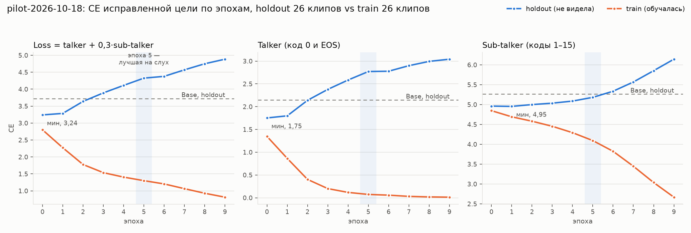
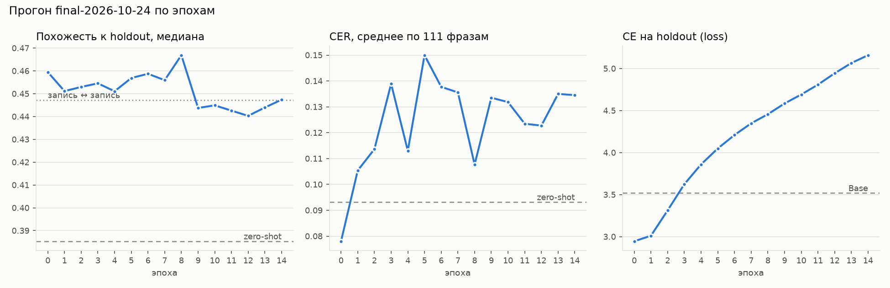

# Дообучение Голоса (этап 5)

Отчёт этапа 5: change `finetune-voice` и исправление цели обучения `fix-voice-sft-alignment`. Кластер `lab-code62`, GPU 1 (RTX 5000 Ada, 32 ГБ). Данные прогонов — `data/voice/<прогон>/` (не в git).

## Ошибка цели обучения

Пробный прогон `pilot-2026-10-17` официальным `sft_12hz.py` на коммите `022e286` дал чекпоинты, которые не заканчивают фразу: каждая эпоха синтезирует до лимита `max_new_tokens`, а Base на том же окружении останавливается сам. Разбор — в `openspec/changes/archive/2026-10-18-fix-voice-sft-alignment/design.md`. Исправление — патч `scripts/voice_train/patches/sft_12hz-alignment.patch`.

Проверка без обучения, 2026-10-18: `scripts/voice_train/check_objective.py pilot-2026-10-17 --clips 16`. Base (`Qwen3-TTS-12Hz-1.7B-Base`, bf16, sdpa), первые 16 клипов `train.codes.jsonl`, батч 2 через `TTSDataset.collate_fn` из vendor, `torch.no_grad`. CE усреднена по всем меткам: talker — код 0 и EOS, sub-talker — коды 1–15.

| Цель | talker | sub-talker |
|---|---|---|
| исходная (`022e286`) | 11,698 | 9,418 |
| исправленная (с патчем) | **2,088** | **5,161** |
| случайное угадывание, ln(2048) | 7,625 | 7,625 |

Исходная цель на собственных кодах Base хуже случайного угадывания по обеим частям: скрипт учит модель другой задаче, чем та, которую решает синтез. Исправленная цель ниже случайной и ниже исходной, то есть совпадает с тем, что Base и так умеет. Критерий спеки выполнен, обучать с патчем можно.

CE sub-talker с патчем по кодбукам 1–15 (8 клипов): 3,87 → 4,64 → … → 5,63, растёт монотонно, как энтропия остаточных кодов RVQ. Если подать sub-talker состояние того же кадра, как в исходном скрипте, CE выше на каждом кодбуке: 9,74 на первом и 6,1–6,5 на остальных. Значит, верно именно состояние предыдущего шага.

## Пробный прогон с исправлением

### Пробный запуск `smoke-fix`

2026-10-18: `train.sh smoke-fix --limit 10 --epochs 1`, патч наложен `train.sh` на чистый клон `022e286`, в `run.json` записан `qwen3_tts_patch` = `8e08c9a7…2e96`. Loss на первом шаге — 3,88; проверка цели предсказывала 2,09 + 0,3 · 5,16 ≈ 3,64. Чекпоинт — `custom_voice`, говорящий `prototype` (ID 3000).

`check_stop.py smoke-fix`: лимит 400 токенов (~32 с), сид 0, длительность в секундах.

| Модель | ф0 | ф1 | ф2 | ф3 | ф4 | Итог |
|---|---|---|---|---|---|---|
| Base, zero-shot | 2,96 | 1,28 | 1,84 | 2,24 | 2,32 | останавливается |
| `smoke-fix` эпоха 0 | 4,00 | 1,12 | 1,92 | 3,04 | 3,28 | пригоден, 0,88–1,41× от Base |

Фразы — `config/eval/stop_phrases_ru.txt`: ф0 «Привет! Ну что, сегодня опять до трёх ночи сидим?», ф1 «Да ладно, не может быть.», ф2 «Слушай, а кто вчера выиграл?», ф3 «Я сейчас вернусь, подождите минуту.», ф4 «Ну всё, я пошёл спать, всем пока.».

### Проверка остановки на старом пилоте `pilot-2026-10-17`

`check_stop.py pilot-2026-10-17` подтверждает симптом: все 10 чекпоинтов непригодны. Эпоха 0 остановилась сама на двух фразах из пяти (7,12 и 5,52 с, вне 2× от Base), эпоха 1 — на одной, эпохи 2–9 дошли до лимита (31,92 с) на всех фразах. Base на тех же фразах останавливается.

### Пробный прогон `pilot-2026-10-18`

2026-10-18, коммит репозитория `e901a6c`, QwenLM `022e286` с патчем `8e08c9a7…2e96`. Тот же манифест, что у `pilot-2026-10-17`: 192 сегмента, 17,19 мин, тот же референс. 10 эпох по 96 шагов, батч 2, накопление 4, `lr=2e-5`, bf16, GPU 1. Обучение заняло 14,5 мин. Второй запуск `train.sh` на клоне сообщил «патч выравнивания уже наложен».

Loss — среднее по записям лога (каждые 10 шагов) и последняя запись эпохи. С loss старого пилота не сравнивается: цель другая.

| Эпоха | 0 | 1 | 2 | 3 | 4 | 5 | 6 | 7 | 8 | 9 |
|---|---|---|---|---|---|---|---|---|---|---|
| среднее | 3,39 | 2,75 | 2,09 | 1,71 | 1,39 | 1,31 | 1,21 | 1,09 | 0,93 | 0,79 |
| последняя запись | 3,20 | 2,48 | 2,20 | 1,62 | 1,42 | 1,43 | 1,17 | 1,08 | 1,02 | 0,73 |

`check_stop.py pilot-2026-10-18`, фразы те же, что выше; в скобках — доля от Base.

| Модель | ф0 | ф1 | ф2 | ф3 | ф4 | Итог |
|---|---|---|---|---|---|---|
| Base, zero-shot | 2,96 | 1,28 | 1,84 | 2,24 | 2,32 | останавливается |
| эпоха 0 | 4,32 | 2,08 (1,63) | 2,96 | 2,96 | 2,40 | пригоден |
| эпоха 1 | 3,36 | **2,64 (2,06)** | 2,08 | 2,72 | 3,20 | непригоден: ф1 > 2× |
| эпоха 2 | 4,08 | **3,28 (2,56)** | 3,60 (1,96) | 3,36 | 2,72 | непригоден: ф1 > 2× |
| эпоха 3 | 4,64 | 1,68 | 2,48 | 2,64 | 3,04 | пригоден |
| эпоха 4 | 4,40 | 2,32 | 2,08 | 3,12 | 2,24 | пригоден |
| эпоха 5 | 3,36 | 2,32 | 1,44 | 3,20 | 2,80 | пригоден |
| эпоха 6 | 4,00 | 1,68 | 1,60 | 2,72 | 2,80 | пригоден |
| эпоха 7 | 3,76 | 1,68 | 2,80 | 3,12 | 2,96 | пригоден |
| эпоха 8 | 2,72 | 1,76 | 2,08 | 2,64 | 2,64 | пригоден |
| эпоха 9 | 4,16 | 2,32 | 2,56 | 3,44 | 3,12 | пригоден |

Ни один чекпоинт не дошёл до лимита: исправление цели вернуло Голосу умение заканчивать фразу. Эпохи 1 и 2 остановились сами, но не прошли по длительности на самой короткой фразе ф1, где у Base 1,28 с. Длительность по эпохам не падает (ф0: 4,32 → 4,16 с), то есть ускорения речи из issue #179 по этим цифрам не видно; на слух — задача 3.4.

WAV — `data/voice/pilot-2026-10-18/stop_check/` и `data/voice/pilot-2026-10-17/stop_check/` на Mac.

**Прослушивание (владелец, 2026-10-18).** Прослушаны `stop_check/` Base и чекпоинтов нового пилота. Прогрессия по эпохам хорошо слышна, голос остаётся речью. Лучшая — эпоха 5, немного уступает ей эпоха 9. Ускорения речи от эпохи к эпохе (issue #179) нет и по длительностям в таблице выше.

**Решение владельца по эпохам 1 и 2.** По требованию «Дообученный Голос заканчивает фразу» они непригодны: длительность ф1 больше 2× от Base. На оценку похожести и CER не передаются. Остальные чекпоинты, 0 и 3–9, требованию соответствуют.

### Кривая на отложенной выборке

2026-10-18: `scripts/voice_train/check_holdout.py pilot-2026-10-18`. Цель — как в патче, teacher forcing, `no_grad`. Holdout — 26 сегментов (1,92 мин), модель их не видела. Train — первые 26 клипов обучающей выборки. Loss = talker + 0,3 · sub-talker, как в `sft_12hz.py`. У чекпоинтов говорящий — строка 3000 `codec_embedding`, у Base — `speaker_encoder` по референсу.

| Модель | holdout talker | holdout sub-talker | **holdout loss** | train talker | train sub-talker | train loss |
|---|---|---|---|---|---|---|
| Base | 2,145 | 5,264 | 3,725 | 2,056 | 5,253 | 3,632 |
| эпоха 0 | **1,752** | 4,961 | **3,240** | 1,347 | 4,846 | 2,801 |
| эпоха 1 | 1,798 | **4,954** | 3,285 | 0,864 | 4,692 | 2,272 |
| эпоха 2 | 2,139 | 5,000 | 3,639 | 0,403 | 4,581 | 1,777 |
| эпоха 3 | 2,379 | 5,035 | 3,889 | 0,201 | 4,453 | 1,537 |
| эпоха 4 | 2,585 | 5,088 | 4,111 | 0,118 | 4,292 | 1,405 |
| эпоха 5 | 2,771 | 5,181 | 4,325 | 0,073 | 4,093 | 1,301 |
| эпоха 6 | 2,777 | 5,336 | 4,378 | 0,057 | 3,823 | 1,204 |
| эпоха 7 | 2,899 | 5,568 | 4,570 | 0,030 | 3,447 | 1,064 |
| эпоха 8 | 2,994 | 5,852 | 4,749 | 0,018 | 3,037 | 0,930 |
| эпоха 9 | 3,042 | 6,142 | 4,884 | 0,013 | 2,668 | 0,813 |



График — `scripts/voice_train/plot_holdout.py` по `holdout_ce.json`.

- **Минимум на holdout — эпохи 0–1**, дальше CE растёт монотонно. Talker хуже Base с эпохи 3, sub-talker — с эпохи 6.
- **Talker запоминает обучающие клипы.** CE на train 0,20 к эпохе 3 и 0,013 к эпохе 9: модель почти детерминированно воспроизводит коды кадра 0 знакомых записей. Sub-talker запоминает медленнее, но к эпохе 9 его CE на train вдвое ниже, чем на holdout.
- **Расхождение со слухом.** На слух лучшие эпохи 5 и 9, по CE на holdout — 0–1. CE штрафует за неуверенность в точных кодах незнакомой фразы: темп, паузы, интонацию. Тембр при этом может продолжать приближаться к Прототипу. Поэтому CE — признак переобучения, а не правило выбора чекпоинта. Выбирать — по похожести и CER на holdout (задачи 4.x и 7.1 `finetune-voice`) и на слух.
- **Вывод для текущих данных.** Больше эпох на этих 17 минутах не нужно: к эпохе 9 модель выучила обучающие записи почти наизусть. Окно между «выучил голос» и «запомнил записи» — эпохи 1–5, то есть 24–144 шага оптимизатора.

### Проба эпохи 5 в Клоне на Mac

2026-10-18, вне задач `finetune-voice`, для ранней проверки. Эпоха 5 — лучшая на слух — перенесена на Mac и сконвертирована штатно:

```bash
uv run --group tts-mlx python -m mlx_audio.convert --hf-path data/voice/pilot-2026-10-18/checkpoint-epoch-5 --mlx-path data/models/pilot-2026-10-18-e5-mlx-8bit --quantize --q-bits 8
```

`mlx-audio` 0.5.9 конвертирует `custom_voice` без ошибок. Модель весит 2,9 ГБ, в конфиге сохранились `tts_model_type = "custom_voice"` и говорящий `prototype` (ID 3000). Клон подключается без правок кода — двумя строками в `config/settings.local.toml`: `model` — путь к конвертации, `speaker = "prototype"`.

Синтез — через `terebot.voice.MlxVoice`, как в ядре: стриминг 0,5 с, лимит кэша 1 ГБ, сид 0, фразы `config/eval/stop_phrases_ru.txt`. MacBookPro18,1 (M1 Pro, 16 ГБ). WAV — `data/voice/pilot-2026-10-18/mac_e5/`.

| | ф0 | ф1 | ф2 | ф3 | ф4 |
|---|---|---|---|---|---|
| длительность, с | 3,60 | 1,84 | 3,12 | 2,80 | 2,80 |
| первый звук, с | 0,31 | 0,30 | 0,29 | 0,31 | 0,30 |
| RTF | 0,55 | 0,58 | 0,56 | 0,55 | 0,55 |

- **Загрузка и прогрев** — 6,6 с.
- **Пик памяти MLX** (`mlx.get_peak_memory`) — 3,54 ГБ. Пик всего процесса не замерялся, поэтому с 4,44 ГБ zero-shot этапа 3 это сравнивается не напрямую.
- **Скорость.** Первый звук вдвое быстрее zero-shot (0,59 с), RTF ниже (0,72): у `custom_voice` нет референса в начале запроса.
- **Остановка.** Все фразы закончились сами.
- **Оценка владельца** после живого разговора с Клоном: «звучит уже невероятно круто».

Это ранний прогон задач 5.1–5.2 `finetune-voice` в упрощённом виде, без сравнения своей квантизации с `mlx-community` и без полного бенчмарка. Этих задач он не закрывает.

**Итоговая оценка пилота (владелец, 2026-10-24).** Пилот в целом звучал нормально, но в нём часто встречались артефакты и неразборчивая речь. Полную оценку пилота (задачи 7.1–7.3 `finetune-voice`) не проводили: финальный прогон на полном датасете с отступами тишины сделал её ненужной.

### Что дальше по этапу 5

Этап 5 продолжается по change `finetune-voice`. Пробный прогон из её задачи 7.1 — `pilot-2026-10-18`. На кластере по решению владельца оставлены только эпохи 5 и 9, остальные удалены; оценка идёт на них. Прогон воспроизводим по `run.json`: коммит QwenLM `022e286`, отпечаток патча `train.qwen3_tts_patch`, коммит репозитория `train.repo_commit` = `e901a6c`. Проверка в задачах 4.2 и 5.2 `finetune-voice` идёт на `checkpoint-epoch-0` прогона `smoke-fix`. Старые прогоны `smoke` и `pilot-2026-10-17` для оценки непригодны.


## Финальный прогон `final-2026-10-24`

2026-10-24, коммит репозитория `c194a44`, QwenLM `022e286` с патчем `8e08c9a7…2e96`. Полный датасет этапа 4: 685 сегментов, 60,63 мин; отложенная выборка — 78 сегментов, 6,75 мин, зафиксирована в каталоге прогона. Референс — тот же сегмент, что у пилота (14,8 с). **Отступы тишины** 150 мс в начале и 300 мс в конце каждого сегмента и референса (`pad_ms` в `run.json`). 15 эпох по 343 шага, батч 2, накопление 4, `lr=2e-5`, bf16, GPU 1. Обучение — 34 мин, ~2,2 мин на эпоху; чекпоинт — 4,3 ГБ.

### Кривая

Оценка — `synth_eval.py` по 15 эпохам и zero-shot Base с тем же референсом: 78 текстов отложенной выборки и 33 фразы бенчмарка, сид 0. Метрики — `voice_eval --refs data/voice/final-2026-10-24/holdout`, опорный уровень «запись ↔ запись» по 78 эталонам — **0,447**. CER — по GigaAM, он пишет числа цифрами, поэтому числительные в текстах holdout дают CER и у zero-shot.

| Модель | Похожесть | CER мед. | CER сред. | holdout | homograph | long | numbers | phrase | short | slang |
|---|---|---|---|---|---|---|---|---|---|---|
| zero-shot | 0,385 | 0,000 | 0,093 | 0,018 | 0,000 | 0,006 | 0,187 | 0,000 | 0,000 | 0,125 |
| эпоха 0 | 0,459 | 0,032 | 0,078 | 0,043 | 0,000 | 0,011 | 0,084 | 0,000 | 0,000 | 0,094 |
| эпоха 1 | 0,451 | 0,065 | 0,105 | 0,080 | 0,000 | 0,119 | 0,032 | 0,000 | 0,133 | 0,065 |
| эпоха 2 | 0,453 | 0,067 | 0,114 | 0,077 | 0,000 | 0,034 | 0,037 | 0,000 | 0,308 | 0,068 |
| эпоха 3 | 0,455 | 0,078 | 0,139 | 0,091 | 0,000 | 0,023 | 0,091 | 0,000 | 0,111 | 0,259 |
| эпоха 4 | 0,451 | 0,063 | 0,113 | 0,071 | 0,000 | 0,023 | 0,051 | 0,000 | 0,111 | 0,097 |
| эпоха 5 | 0,457 | 0,091 | 0,150 | 0,074 | 0,097 | 0,017 | 0,127 | 0,049 | 0,500 | 0,094 |
| эпоха 6 | 0,459 | 0,078 | 0,138 | 0,082 | 0,000 | 0,023 | 0,296 | 0,000 | 0,267 | 0,159 |
| эпоха 7 | 0,456 | 0,067 | 0,136 | 0,061 | 0,000 | 0,034 | 0,190 | 0,000 | 0,500 | 0,161 |
| **эпоха 8** | 0,467 | 0,064 | 0,108 | 0,060 | 0,029 | 0,164 | 0,048 | 0,000 | 0,250 | 0,094 |
| эпоха 9 | 0,444 | 0,094 | 0,134 | 0,106 | 0,000 | 0,045 | 0,101 | 0,000 | 0,222 | 0,125 |
| эпоха 10 | 0,445 | 0,094 | 0,132 | 0,098 | 0,069 | 0,034 | 0,061 | 0,073 | 0,000 | 0,159 |
| эпоха 11 | 0,443 | 0,063 | 0,123 | 0,073 | 0,000 | 0,045 | 0,051 | 0,000 | 0,000 | 0,159 |
| эпоха 12 | 0,440 | 0,078 | 0,123 | 0,070 | 0,000 | 0,023 | 0,156 | 0,000 | 0,333 | 0,159 |
| эпоха 13 | 0,444 | 0,089 | 0,135 | 0,090 | 0,000 | 0,045 | 0,121 | 0,000 | 0,333 | 0,114 |
| эпоха 14 | 0,447 | 0,087 | 0,135 | 0,108 | 0,000 | 0,034 | 0,035 | 0,000 | 0,111 | 0,159 |



График — `scripts/voice_train/plot_curve.py`. CE на holdout (`check_holdout.py`, цель — как в патче): минимум на эпохе 0 (2,95 против 3,52 у Base), дальше рост; хуже Base с эпохи 3. На обучающих клипах CE talker к эпохе 6 — 0,065, к эпохе 14 — 0,005.

- **Похожесть перестала расти на эпохе 0.** Сразу 0,459 при zero-shot 0,385 — на уровне «запись ↔ запись», дальше колебания 0,44–0,467 в пределах шума метрики.
- **Разборчивость.** Лучший средний CER — у эпохи 0 (0,078, лучше zero-shot 0,093, на числах вдвое). Дальше 0,11–0,15. Медианный CER zero-shot — 0: больше половины его фраз распознаны без ошибок, и правило «медиана не выше zero-shot» не проходит ни одна эпоха.
- **Артефакты поздних эпох** — на коротких фразах: лишний звук в хвосте («Погоди, я сейчас» → «…и-и-и»), проглоченное последнее слово («Вот это поворот!» → «Вот это..»), смазанная артикуляция. Последнее слово потеряно или искажено у zero-shot в 13 фразах из 111, у эпохи 0 — в 15, у эпохи 8 — в 19. Вероятная причина — сами данные: живая речь с оговорками и растягиваниями («о-одна», «пере-перегруженный», «э-э»), которые Голос перенимает тем точнее, чем дольше учится.

**Отступы работают.** Тишина по краям всех 111 фраз: у zero-shot медиана в начале 340 мс, в конце — 70 мс, впритык к краю (< 50 мс в начале или < 100 мс в конце) 82 фразы из 111. У эпох 0 и 8 — ~200 мс и ~510 мс, впритык ни одной. Обрезки краёв звука у дообученного Голоса нет.

**Проверка остановки** (`check_stop.py`): все 15 эпох заканчивают фразу сами, ни одна не дошла до лимита. Формально «непригодны» эпохи 2, 5, 6 и 14 — длительность > 2× от Base на коротких фразах ф1 и ф2; часть этого — отступы: Голос добавляет ~0,3 с тишины сверх Base. Вопрос о критерии — в design.md, Open Questions.

### Выбор чекпоинта

**Эпоха 8 — решение владельца на слух** (2026-10-24, подборка `data/voice/final-2026-10-24/listen/`: zero-shot, эпохи 0, 4, 8, живые записи): «лучше остальных, хотя иногда обрезается или звук будто человек пьяный». «Обрезается» — не срез краёв звука (см. выше), а проглоченные и смазанные концы слов. По метрикам эпоха 8: пик похожести 0,467, средний CER 0,108 (+0,015 к zero-shot, в пределах +0,02 правила), медианный 0,064. Правило из design.md не выбрало ни одной эпохи из-за медианы zero-shot, равной 0; по метрикам лучшая — эпоха 0. **Исключение из правила выбора** (решение владельца 2026-10-24): по медианному CER эпоха 8 правило не проходит, по среднему — проходит; пункт о медиане при нулевой медиане zero-shot вынесен в Open Questions design.md. Для сравнения в Диалоге на Mac сконвертирована и эпоха 12 (`data/models/final-2026-10-24-e12-mlx-8bit`). Если в живом Диалоге «пьяность» будет мешать, следующий кандидат — эпоха 0: чекпоинты на кластере сохранены до этого решения.

### Голос на Mac

Своя конвертация `mlx_audio.convert --quantize --q-bits 8` Base совпала с `mlx-community/Qwen3-TTS-12Hz-1.7B-Base-8bit` байт в байт (sha256 `model.safetensors` `b965c581…`), бенчмарк конфигурации 3 с LLM дал те же 33 WAV. Эпоха 8 — `data/models/final-2026-10-24-e8-mlx-8bit` (2,9 ГБ, `custom_voice`, `prototype` = 3000).

Бенчмарк с LLM (`llama-server` Qwen3.5-4B Q4_K_M, прогрет), `--streaming-interval 0.5 --cache-limit-gb 1.0`, 33 фразы, MacBookPro18,1 (M1 Pro, 16 ГБ). Каталоги — `data/bench/2026-10-24_20-38-25-3-llm` и `data/bench/2026-10-24_20-44-08-7-final-e8-llm`.

| | zero-shot (конф. 3) | **эпоха 8 (конф. 7)** |
|---|---|---|
| RTF медиана / p90 | 0,79 / 0,95 | **0,61 / 0,62** |
| Первый звук, медиана | 0,68 с | **0,33 с** |
| Загрузка | 9,7 с | 7,2 с |
| Пик Голоса (MLX active + cache) | 4,49 ГБ | **3,86 ГБ** |
| Swap за прогон | 2,16 → 4,49 ГБ | 4,64 → 4,64 ГБ |

RTF < 1 и бюджет ~5 ГБ выполнены, swap в прогоне эпохи 8 не рос. Первый звук вдвое быстрее zero-shot: у `custom_voice` нет префилла референса.

**Сверка Mac ↔ кластер** на 33 фразах бенчмарка, эталоны — holdout: эпоха 8 — похожесть 0,441 против 0,451, средний CER 0,144 против 0,119. Синтез сэмплирующий, ГСЧ MLX и PyTorch разные, выборка мала — расхождение в пределах этого шума. Zero-shot на Mac заметно хуже, чем на кластере (0,252 против 0,364 на тех же фразах); дообученного Голоса это не касается, причину не искали.
